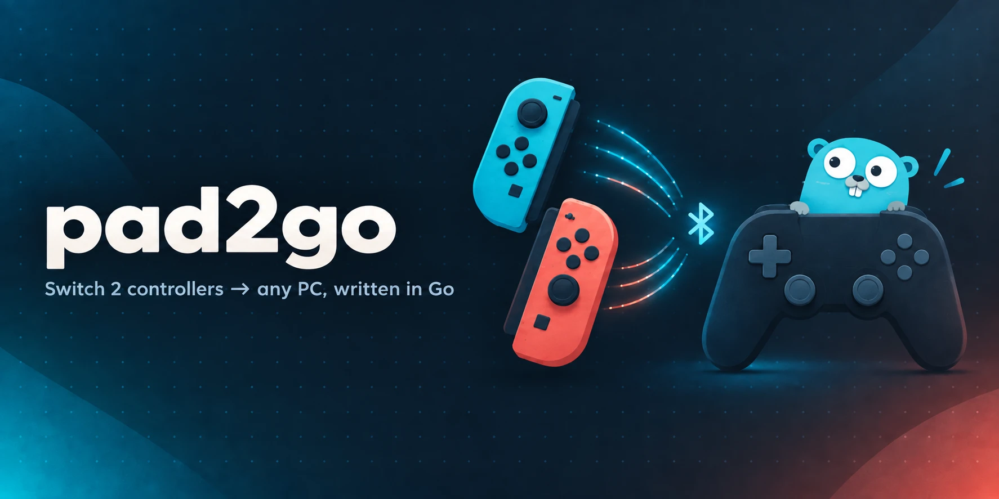

# pad2go



> Not affiliated with or endorsed by Nintendo. Nintendo Switch, Joy-Con and
> related names are trademarks of Nintendo, used here only to describe
> compatibility.

pad2go is a controller bridge and desktop app written in Go. Connect **Switch 2
Joy-Cons**, the **Switch 2 Pro Controller** and the **NSO GameCube Controller**
over Bluetooth LE, or use a **PlayStation 5 DualSense** over USB or Bluetooth
on Windows. pad2go provides virtual **Xbox 360**, **DualSense** or **Switch Pro**
output, button remapping, rumble and an optional **CemuHook/DSU** motion server
for emulators.

The project began as a Go port of
[TommyWabg/Switch2Connect](https://github.com/TommyWabg/Switch2Connect) and has
grown beyond that starting point with PlayStation support and a cross-platform
desktop app.

It is a single static binary with no Python runtime. It also runs on Linux
(uinput) as well as Windows (ViGEmBus), and the DSU server works on macOS too.

Its initial implementation was based on upstream commit `e5dd90b`
(2026-09-13).

## Quick start

pad2go is a single executable. Running it opens the Pad2Go window, which
shows players, connection progress, an input test, motion (DSU), button
mapping (Mapeamento) and settings.
Settings are saved to `config.yaml` in your user config folder, or to
`./config.yaml` if one exists; use `-config` to choose another.

Then hold **SYNC** on an unpaired controller, or press any button on one
already paired to this PC. Controllers paired by pad2go reconnect with a
button press next time.

Flags:
- `-headless`: run without a window (add `-open` to use the browser).
- `-demo`: simulate controllers, to try the interface without hardware.
- `-v`: debug logging.

`pad2go.log` is written next to the config file.

### Build

```bash
go build ./cmd/pad2go
```

The window uses the system WebView through cgo:
- **macOS:** WKWebView. `packaging/build-macos-app.sh` wraps the executable in
  `Pad2Go.app`, so a double-click opens the window instead of Terminal and
  macOS asks for Bluetooth permission for Pad2Go.
- **Windows:** WebView2, which is preinstalled on Windows 10/11.
  `packaging/build-windows.sh` cross-compiles `pad2go.exe` with MinGW-w64 in
  Docker: GUI subsystem (no console), WebView2 loader and C++ runtime linked
  in, only Windows system DLLs imported. The ViGEm client SDK is compiled in
  too (`internal/virtualpad/vigemclient`), so no `ViGEmClient.dll` ships.
  `packaging/windows/include` supplies the `EventToken.h` that MinGW lacks.
  `packaging/build-windows-installer.sh` wraps it in an NSIS installer that
  bundles the ViGEmBus driver.
- **Linux:** GTK 3 and WebKitGTK. On Debian 12 install `libwebkit2gtk-4.0-dev`.
  Newer distros (Debian 13, Ubuntu 24.04+) only ship 4.1: install
  `libwebkit2gtk-4.1-dev` and build with `PKG_CONFIG_PATH=$PWD/packaging/linux`,
  which maps the 4.0 name that webview_go expects to 4.1.

The `nowebview` build tag drops the window and opens the browser instead.
The interface follows each platform: on macOS a translucent sidebar and System
Settings-style lists; on Windows, Fluent; on Linux, Adwaita. Dark mode
follows the system.
`nobluetooth` builds without Bluetooth, for development with `-demo`.

Publishing a GitHub release runs `.github/workflows/release.yml`, which
attaches a universal `Pad2Go.app` disk image (`packaging/build-macos-dmg.sh`),
the Windows installer and `pad2go.exe` (zip), Linux amd64/arm64 tarballs and
`SHA256SUMS` to the release.

### Windows

Run `pad2go-<version>-windows-amd64-setup.exe`. It installs Pad2Go and, if
no working ViGEmBus is found (`pad2go check`), the bundled
[ViGEmBus](https://github.com/nefarius/ViGEmBus) 1.22.0 driver. Uninstalling
Pad2Go leaves ViGEmBus in place for other apps.

With the standalone `pad2go.exe` (zip), install ViGEmBus yourself. Without
ViGEmBus, controllers still connect for the input test and DSU motion, but
games don't see an Xbox controller.

Hide the physical controller from games with HidHide if you see doubled input.

**Windows SmartScreen.** Until releases are Authenticode-signed, SmartScreen
shows "Windows protected your PC". Click *More info* → *Run anyway*.

**Windows Defender false positive.** The executables are not code-signed yet,
and Defender's machine-learning heuristics may flag a build of `pad2go.exe`
as `Trojan:Win32/Bearfoos.A!ml` and quarantine it, sometimes right after
install. This is a false positive: the detection varies from build to build
(1.0.0 is not flagged), and the source and release workflow are in this
repository. Until the binaries are signed and the build is cleared by
Microsoft, you can:

- check the download against `SHA256SUMS` from the release;
- restore it from Windows Security → Protection history, or add an exclusion
  for `C:\Program Files\Pad2Go` only (Windows Security → Virus & threat
  protection → Manage settings → Exclusions);
- report the false positive at <https://www.microsoft.com/wdsi/filesubmission>.

### Linux

Requires BlueZ and write access to `/dev/uinput`:

```bash
sudo modprobe uinput
```

Add a udev rule (e.g. `KERNEL=="uinput", GROUP="input", MODE="0660"`) or run as root.

For a launcher entry with the app icon, put `pad2go` on your `PATH`, then:

```bash
install -Dm644 pad2go.desktop ~/.local/share/applications/pad2go.desktop
install -Dm644 pad2go.png ~/.local/share/icons/hicolor/1024x1024/apps/pad2go.png
```

### macOS

macOS has no virtual gamepad API, so pad2go feeds emulators over DSU only: turn
on **Movimento** and point the emulator's CemuHook/UDP input at
`127.0.0.1:26760`. DSU carries buttons (Home as PS, Capture as the touchpad
click), both sticks and motion, so emulators that take DSU as a controller
(Eden and other yuzu forks) work without a virtual gamepad. A combined Joy-Con
pair is one DSU pad with the motion of the side set by `joycon_pair_gyro`.
macOS doesn't expose the adapter MAC, so set it in Ajustes → Conexão if you
want pairing.

## Configuration

`pad2go init` writes a commented `config.yaml`. Key names match the
original's `config.yaml`, and an existing original config loads as-is (unknown
keys are ignored; `button_remaps.xbox` overrides apply).

| Key | Meaning |
| --- | --- |
| `output` | `auto`, `vigem`, `uinput`, `xbox`, `dualsense`, `switch` or `none` |
| `output_overrides` | per-controller output by MAC: `auto`, `xbox`, `dualsense`, `switch` or `none` |
| `output_remaps` | virtual button remaps by scope: `global` plus `xbox`/`dualsense`/`switch` overrides, in protocol button names (`None` clears a button) |
| `host_mac` | this PC's Bluetooth MAC; auto-detected on Windows/Linux |
| `abxy_mode` | `Xbox` (positional: Switch B → Xbox A) or `Switch` (by label) |
| `combine_joycons` | merge a left + right Joy-Con into one pad |
| `joycon_pair_gyro` | `Right` / `Left`: which Joy-Con of a pair sends motion over DSU |
| `default_hold_mode`, `joycon_hold_mode` | `Vertical` / `Horizontal` for single Joy-Cons |
| `gc_trigger_mode` | `Hair Trigger`, `100% at Bump`, `100% at Max` |
| `joystick_deadzone_percent` | per family: `joycon`, `pro_controller`, `nso_gamecube_controller` |
| `vibration_strength_xbox` | 0–10 (5 = 100%) |
| `dualsense_remaps` | map physical DualSense buttons to Xbox positional buttons |
| `dualsense_lighting`, `dualsense_color`, `dualsense_brightness`, `dualsense_player_led` | DualSense light bar and player LEDs |
| `dualsense_trigger_left`, `dualsense_trigger_right` | DualSense adaptive trigger presets |
| `gyro_passthrough_mode` | `Cemuhook` enables the DSU server (`cemuhook_host`, `cemuhook_port`) |
| `home_mapping`, `capt_mapping`, `c_mapping`, `gl_mapping`, `gr_mapping`, `sll/srl/slr/srr_mapping` | `Default`, `None`, or a Switch button name |

`output: dualsense` creates a virtual DualSense instead of an Xbox 360 pad. It carries touch, motion, analog triggers and rumble, and requires WinUHid on Windows (`\\.\WinUHid`) or `/dev/uhid` on Linux. `auto` chooses DualSense for a physical DualSense and Xbox 360 for Nintendo controllers. If a game sees both the physical and the virtual DualSense, hide the physical one with HidHide.

`output: switch` creates a virtual Switch Pro Controller with both sticks, the full button set, rumble and gyro/accelerometer. Switch emulators discover it through SDL2's HIDAPI Switch driver; select the **Pro Controller** entry in the emulator. It uses the same WinUHid/`/dev/uhid` backend as the DualSense output. `auto` does not choose it, because a Switch pad is only wanted by emulators that understand the Switch protocol.

On the main screen, **Saída padrão** selects the output for new players, and each player card has its own output selector, whose first option names what the default gives that player (e.g. `DualSense (padrão)`). `Automática` sends a physical DualSense to a virtual DualSense and Nintendo controllers to Xbox 360. A per-player choice is saved by MAC in `output_overrides`; changing it recreates only that player's pad.

The **Mapeamento** tab lists remaps in the order they apply: **No controle físico** (extra buttons and DualSense buttons, before the layout) and **Na saída virtual**, which remaps virtual buttons by output. The built-in positional mapping stays the default; a `global` table applies everywhere and each output can override individual buttons. Targets use the protocol button names (`A`, `B`, `ZL`, `HOME`, `MUTE`, `PS_C_Click`, ...), `Padrão` keeps the built-in mapping and `Sem ação` clears the button. Remaps are applied before the output encoder, and the Xbox report is rebuilt from the remapped input. **Restaurar <saída>** clears only the selected output after a confirmation, and the input test lists the remaps running on that player (`· Remapeado: B → X`).

## Controller and output support

| Feature | Status |
| --- | --- |
| PlayStation 5 DualSense input over USB/Bluetooth HID (Windows) | ✅ |
| DualSense adaptive triggers, light bar and player LEDs | ✅ |
| BLE discovery, pairing/bonding, reconnect-by-button | ✅ |
| SW2 init sequence, input format 0x30, feature enable | ✅ |
| Factory/user stick calibration, radial deadzones | ✅ |
| Joy-Con 2 L/R, Pro Controller 2, NSO GameCube (analog triggers, trigger modes) | ✅ |
| Player LEDs, connection haptics | ✅ |
| Joy-Con merging, vertical/horizontal single Joy-Con | ✅ |
| Xbox 360 output via ViGEmBus (Windows) | ✅ |
| Xbox 360 output via uinput (Linux) | ✅ |
| DualSense virtual output via WinUHid (Windows) or uhid (Linux) | ✅ (driver required) |
| Switch Pro virtual output via WinUHid (Windows) or uhid (Linux) | ✅ (driver required) |
| Game rumble → HD rumble (LF/HF, strength, delay) | ✅ (basic mapping) |
| CemuHook/DSU motion server | ✅ |
| Extra-button remaps to controller buttons | ✅ |
| Keyboard/mouse/media remaps, gyro mouse, IR mouse | ❌ |
| PS4 controller input and Switch 2 emulation (WinUHid, USBIP) | ❌ |
| DualSense audio haptics and Xbox impulse triggers | ❌ |
| ESP32-S3 bridge, wired USB | ❌ |
| Profiles, power saving, auto-disconnect, GUI/tray | ❌ |

The original is ~58k lines of Windows-specific Python. pad2go implements the
controller protocols, virtual Xbox output and DSU motion, and adds PlayStation
support and a cross-platform desktop app. Some original Windows-specific
drivers, firmware and integrations remain out of scope.

### Behavioural differences

- Rumble uses the original's basic ViGEm mapping (`amp = 800·motor/256`, scaled
  by strength, re-sent at 60 Hz). The tuned frequency masks and audio-haptic mixing are not ported.
- For a horizontal right Joy-Con with `abxy_mode: Switch`, the original's
  face-button table is not a rotation of its `Xbox` table. This port uses the
  rotation for both layouts.
- The DSU server converts calibrated [-1, 1] stick values to 0–255, Y plus
  upward as the CemuHook protocol defines. The original scaled them as if they
  were raw 0–4095 readings.

## Performance

Compared with the original Python on the same inputs (Apple M1 Pro), per-report
processing is about 47× faster (12.3 µs → 0.26 µs) and startup drops from ~470 ms/70 MB
to under 10 ms/11 MB. Both add latency far below the BLE link's own 7.5–15 ms.
See [bench/RESULTS.md](bench/RESULTS.md).

## Development

```bash
go test -race ./...
```

Protocol encodings are checked against golden values produced by the original
Python code. The controller handshake is tested against a simulated controller,
and the DSU server over real UDP. `S2C_UINPUT_IT=1` enables an end-to-end uinput
test (needs root and `/dev/uinput`), and `S2C_VIGEM_IT=1` one for ViGEmBus that
reads the pad back through XInput (needs the driver).

Layout:

```
cmd/pad2go   CLI
internal/protocol    BLE protocol: UUIDs, commands, reports, calibration, rumble
internal/controller  per-controller handshake, commands, input, rumble
internal/lifecycle   connection lifecycle: accept, connect, pair, attach, drops
internal/ble         radio adapter over tinygo.org/x/bluetooth
internal/mapping     player pad: remaps, hold mode, Joy-Con pairs, layout, motion
internal/app         player slots, rumble routing, DSU publishing
internal/dsu         CemuHook/DSU UDP server
internal/virtualpad  ViGEmBus (Windows), uinput (Linux), none
internal/service     runtime supervisor: config, restart, snapshot, events
internal/ui          embedded web interface, JSON API, SSE
internal/window      native window (system WebView)
internal/demo        simulated radio for -demo
internal/config      YAML config
```

## License

The banner's gopher is inspired by the Go gopher, designed by Renée French
(CC BY 4.0).


GPL-3.0, same as the upstream project (see `LICENSE`). Protocol knowledge and
constants come from Switch2Connect by TommyWabg.
